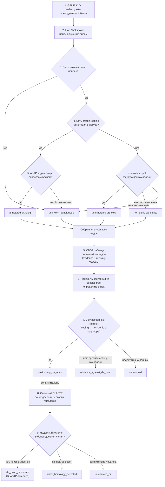

# Synthesis

Репозиторий команды «падаваны ПГ»: поиск **de novo генов** у *Drosophila melanogaster* — сравнение геномов и протеомов, синтения, гомология, классификация происхождения генов.

Методическая основа — статья в *Nature Communications* (2024): [s41467-024-45028-1](https://www.nature.com/articles/s41467-024-45028-1). Авторы нашли 555 кандидатов в de novo гены *D. melanogaster*, возникших в линии Drosophilinae, и описали workflow на основе полногеномных выравниваний (Progressive Cactus), `halLiftover`, all-vs-all BLASTP, GeneWise/Spaln и фильтрации по UniProtKB и NCBI. Мы воспроизводим эту логику и дополняем её двумя собственными подходами (OrthoFinder и поиск ORF в неаннотированной части генома).

---

## Содержание

- [Структура репозитория](#структура-репозитория)
- [Общая схема пайплайна](#общая-схема-пайплайна)
- [Статусы и итоговые метки](#статусы-и-итоговые-метки)
- [Подход 1. OrthoFinder](#подход-1-orthofinder)
- [Подход 2. Поиск ORF в неаннотированной части генома](#подход-2-поиск-orf-в-неаннотированной-части-генома)
- [Наборы генов из статьи](#наборы-генов-из-статьи)
  - [denovogens — 3 гена de novo](#denovogens--3-гена-de-novo)
  - [deletedgenes — гены, отсеянные на этапах](#deletedgenes--гены-отсеянные-на-этапах)
- [Критерии включения гена](#критерии-включения-гена)
- [Как обеспечить разнообразие внутри группы](#как-обеспечить-разнообразие-внутри-группы)
- [Правила оформления ноутбуков (markdown-ячейки)](#правила-оформления-ноутбуков-markdown-ячейки)
- [Виды и версии геномов](#виды-и-версии-геномов)
- [Инструменты](#инструменты)
- [Ограничения интерпретации](#ограничения-интерпретации)

---

## Структура репозитория

| Папка / файл | Содержимое |
|---|---|
| `Orthofinder/` | Классификация белков *D. melanogaster* по результатам OrthoFinder + дополнительный поиск DIAMOND. Скрипты в `Orthofinder/scripts/`, подробное описание в `Orthofinder/README.md` |
| `pipeline_not_annotated/` | Пайплайн поиска потенциальных de novo ORF и repeat-associated ORF в неаннотированной части генома. Описание в `pipeline_not_annotated/README.md` |
| `denovogens/` | FASTA-файлы трёх de novo генов из исследования статьи: `FBgn0029539`, `FBgn0029568`, `FBgn0040357` |
| `deletedgenes/` | Гены из статьи, удалённые из списка кандидатов на этапах фильтрации: `279_genes_raw.txt` (CDS-последовательности ортологов), `genes_not_in_excel.txt` (список 279 FlyBase ID) |
| `README.md` | этот файл |

Часть пайплайна (шаги 1–3 схемы ниже) добавляется в репозиторий дополнительно.

---

## Общая схема пайплайна

Пайплайн делится на **программу-минимум (шаги 1–7)** и **дополнение (шаги 8–9)**.



| № | Шаг | Что происходит |
|---|---|---|
| 1 | GENE ID | По идентификатору гена *D. melanogaster* (FlyBase ID) берём координаты и белок |
| 2 | HAL / halLiftover | По полногеномному выравниванию переносим координаты гена на геномы других видов |
| 3 | Синтеничный локус? | Нет → `unknown / ambiguous`; да → шаг 4 |
| 4 | Аннотация в локусе | Если аннотация есть — проверяем BLASTP; если нет — GeneWise / Spaln проверяют кодирующую гомологию |
| 5 | Таблица состояний | Своя таблица «вид × состояние» с evidence и явными missing-статусами |
| 6 | Species tree | Накладываем состояния на готовое дерево видов, определяем ветвь |
| 7 | Согласованный паттерн | Есть ли переход coding → non-genic в аутгруппах |
| 8 | One-vs-all BLASTP | Поиск древних белковых гомологов вне синтеничного локуса |
| 9 | Гомолог в более древней линии? | Итоговая проверка кандидата |

**Ветви Br1–Br9.** В статье виды разнесены по ветвям по удалённости от *D. melanogaster*. Ветвь возникновения гена — самая дальняя ветвь, где ещё есть ортолог (annotated или unannotated), при условии, что у аутгрупп за ней стоят non-genic хиты и нет гомологов у далёких членистоногих.

**Пороги из статьи (для ориентира):**

- ортолог в аннотированном локусе: E-value < 0.05 в all-vs-all BLASTP;
- кодирующий потенциал неаннотированного локуса: оценка GeneWise/Spaln значимо выше случайных симуляций (P < 10⁻⁶);
- поиск древних гомологов: blastp (E < 0.05), iterative jackhmmer, tblastn; гомолог считается надёжным, если воспроизводится минимум в двух независимых поисках.

---

## Статусы и итоговые метки

**Состояние локуса у вида (шаги 3–4):**

| Статус | Когда ставим |
|---|---|
| `annotated ortholog` | локус аннотирован, BLASTP подтверждает сходство с белком |
| `unannotated ortholog` | аннотации нет, GeneWise/Spaln показывают кодирующую гомологию |
| `non-genic candidate` | аннотации нет, GeneWise/Spaln выполнены, кодирующей гомологии нет |
| `unknown / ambiguous` | локус не найден, BLASTP нет/сомнительно или тест не завершён |

**Итог по гену (шаг 7):** `preliminary_de_novo` · `evidence_against_de_novo` · `unresolved`

**Итог после дополнения (шаг 9):** `de_novo_candidate (BLASTP-screened)` · `older_homology_detected` · `unresolved_hit`

`unknown` и `unresolved` не означают «нет». Для таких случаев в таблице всегда указываем, **каких данных не хватило и почему**.

---

## Подход 1. OrthoFinder (`Orthofinder/`)

Сравнение протеомов 28 видов: 17 видов *Drosophila*, другие двукрылые, представители других отрядов насекомых и внешний таксон *Daphnia magna*. Всего 398 017 белков.

**Запуск:**

```bash
orthofinder \
  -f drosophila_proteomes/proteomes_1isoform \
  -S diamond_ultra_sens \
  -M msa -A mafft -T fasttree \
  -t 16 -a 8
```

OrthoFinder 3.2 (поиск сходства — DIAMOND 2.2.8.188, выравнивание — MAFFT, деревья — FastTree).

**Распределение белков *D. melanogaster* (13 969 белков):**

| Категория | Белков |
|---|---:|
| `ORTHOLOGS_DETECTED` | 8 388 |
| `ORTHOLOGS_AND_DUPLICATION` | 5 513 |
| `HOMOLOGY_GROUP_ONLY` | 4 |
| `UNASSIGNED_CANDIDATE` (не попали ни в одну ортогруппу) | 64 |

**Дополнительный поиск DIAMOND.** Отсутствие белка в ортогруппах ещё не означает отсутствие гомологов, поэтому 9 626 белков, не распределённых по ортогруппам, искали по общей базе всех протеомов (`--ultra-sensitive --evalue 1e-3 --maxtarget-seqs 100`), исключая совпадения внутри одного вида. Из 64 неназначенных белков *D. melanogaster*:

| Результат DIAMOND | Белков |
|---|---:|
| `CROSS_SPECIES_DIAMOND_HIT` | 7 |
| `NO_CROSS_SPECIES_DIAMOND_HITS` | **57** |

**Итоговая сводка:**

| Этап | Результат |
|---|---|
| Белки *D. melanogaster* | 13 969 |
| Белки Dmel с данными об ортологах | 13 901 |
| Белки Dmel без ортогрупп | 64 (7 с межвидовыми хитами, 57 без) |
| Белки Dmel в ортогруппах всех трёх близких видов (трио) | 13 621 |
| Белки Dmel в ортогруппах, ограниченных родом *Drosophila* | 875 |
| Белки Dmel в ортогруппах, ограниченных трио | 19 |

**57 белков без ортогрупп и без межвидовых DIAMOND-хитов — приоритетный набор потенциальных de novo кандидатов.**

**Скрипты (`Orthofinder/scripts/`):**

| Скрипт | Назначение |
|---|---|
| `classify_gene_origin.py` | первичная классификация белков по результатам OrthoFinder |
| `prepare_diamond_search.py` | подготовка запросов и объединённой базы для DIAMOND |
| `analyze_unassigned_diamond.py` | обработка хитов DIAMOND, исключение совпадений внутри вида |
| `filter_dmel_origin.py` | выделение белков Dmel, сводки по классификации и DIAMOND-статусу |
| `extract_trio_ids.py` | ID белков из ортогрупп трио и рода *Drosophila* |
| `extract_dmel_sequences.py` | извлечение последовательностей Dmel по ID |

---

## Подход 2. Поиск ORF в неаннотированной части генома (`pipeline_not_annotated/`)

Цель — найти потенциальные de novo ORF в той части генома *D. melanogaster*, где нет аннотированных генов.

```text
Геном D. melanogaster
 → мягкое маскирование RepeatMasker
 → выделение неаннотированной части генома
 → поиск ORF (start-to-stop): нуклеотидные и белковые FASTA
 → BLASTP белков ORF против 28 протеомов (18 Drosophila + 10 других)
 → фильтр: нет хитов и длина > 100 аа
 → проверка start/stop кодонов и соответствия DNA ↔ protein
 → отбор ORF в пределах 5 kb от аннотированных генов
 → BLASTN против 18 видов Drosophila
 ├─ хиты у D. melanogaster и двух ближайших видов
 └─ хиты только у D. melanogaster
 → проверка связи с повторами (по маске RepeatMasker)
 ├─ repeat-unrelated → кандидаты de novo
 └─ repeat-associated → анализ транспозонов и полноты совпадения
```

**Направление 1 — потенциальные de novo ORF:** ORF без BLASTP-хитов, длиннее 100 аа, с корректными start/stop, рядом с аннотированными генами, с ограниченной распространённостью по BLASTN и без связи с повторами.

**Направление 2 — repeat-associated ORF:** ORF, пересекающиеся с маской RepeatMasker; для них проверяется наличие транспозонных последовательностей, доля покрытия ORF транспозоном и случаи со 100 % и неполным совпадением.

Полное описание с командами — в `pipeline_not_annotated/README.md`.

---

## Наборы генов из статьи

### `denovogens/` — 3 гена de novo

Три гена из исследования статьи (FlyBase r6.57). Все три лежат на X-хромосоме; в файлах — последовательность гена в формате FASTA.

| FlyBase ID | Ген | Координаты | Длина последовательности, bp | Файл |
|---|---|---|---:|---|
| FBgn0029539 | CG11663 | X:894482..895200 | 719 | `denovogens/FBgn0029539.fasta` |
| FBgn0029568 | CG11381 | X:1203777..1205433 | 1657 | `denovogens/FBgn0029568.fasta` |
| FBgn0040357 | CG14624 | X:1206737..1207555 | 819 | `denovogens/FBgn0040357.fasta` |

Для каждого гена проходим шаги пайплайна и заполняем итоговую таблицу состояний по видам.

### `deletedgenes/` — гены, отсеянные на этапах

Гены из статьи, которые на разных этапах фильтрации выпали из списка кандидатов (не вошли в итоговые 555).

| Файл | Содержимое |
|---|---|
| `279_genes_raw.txt` | сырые CDS-последовательности ортологов: для 260 генов по 20 видам (`dmel`, `dsim`, `dsec`, `dyak`, `dere`, `dana`, `dbia`, `dele`, `deug`, `dfic`, `dkik`, `dmir`, `dper`, `dpse`, `drho`, `dtak`, `dwil`, `sleb`, `bdor`, `blat`). Формат заголовка: `>вид\|ID гена\|score_1E10\|shift_No\|номер` |
| `genes_not_in_excel.txt` | список из 279 FlyBase ID удалённых генов |

---

## Критерии включения гена

Ген подходит для набора, если:

1. Есть однозначный идентификатор (например, FlyBase ID).
2. Доступна белковая и/или CDS-последовательность.
3. Известно, в какой сборке генома находятся его координаты.
4. Есть достаточно сравнительных данных для проверки заявленной гипотезы.
5. Источник предварительной классификации можно указать явно.
6. Нет неразрешённого конфликта идентификаторов или аннотаций между версиями генома.

Для группы `unresolved` пункт 4 имеет особый смысл: отсутствие данных само может быть частью неопределённости, но необходимо документировать, какие именно данные отсутствуют и почему.

---

## Как обеспечить разнообразие внутри группы

Если все три de novo гена из одной молодой ветви *Drosophila* и имеют почти идентичные свойства, это слабый тест. Лучше выбрать примеры, отличающиеся хотя бы по одному признаку:

- эволюционная глубина (Br1–Br9);
- длина кодирующей последовательности;
- число экзонов;
- полнота представления среди видов;
- качество и согласованность свидетельств.

При этом на коротком хакатоне доступность качественных данных важнее идеального покрытия всех возможных характеристик.

---

## Правила оформления ноутбуков (markdown-ячейки)

Каждый ноутбук читается сверху вниз как отчёт: **перед каждым шагом пайплайна стоит markdown-ячейка, после шага — markdown-вывод.**

**1. Шапка ноутбука:**

```markdown
# <GENE NAME> (<FlyBase ID>)

**Сборка генома:** ... **Источник классификации:** ...

**Цель:** проверить гипотезу de novo происхождения гена по шагам 1–7 (+ 8–9)

**Итоговая метка:** заполняется в конце
```

**2. Ячейка перед шагом:**

```markdown
## Шаг N. <название шага>

**Что делаем:** одно-два предложения.

**Вход:** файлы / переменные.

**Выход:** что получим.

**Критерий решения:** по какому правилу выбираем статус (например, E-value < 0.05).
```

**3. Ячейка после шага:**

```markdown
**Вывод по шагу N:** какие виды получили какой статус,
что пошло не так (missing / ambiguous) и почему.
```

**4. Финальная ячейка:**

```markdown
## Итог

| Вид | Ветвь | Состояние | Evidence | Комментарий / missing |
|---|---|---|---|---|

**Метка гена:** `preliminary_de_novo` / `evidence_against_de_novo` / `unresolved`

**После шагов 8–9:** `de_novo_candidate` / `older_homology_detected` / `unresolved_hit`
```

Дополнительно: код — только в code-ячейках, пояснения — в markdown; пороги (E-value, версии сборок) вынесены в начало ноутбука и описаны текстом; перед коммитом ноутбук перезапускается сверху вниз (Restart & Run All).

---

## Виды и версии геномов

| Вид | Источник / сборка |
|---|---|
| *D. melanogaster* | FlyBase r6.36 (пайплайн ORF); r6.57 (файлы `denovogens/`) |
| *D. simulans* | GCF_000754195.2 |
| *D. sechellia* | GCF_004382195.1 |
| *D. yakuba* | GCF_000005975.2 |
| *D. erecta* | GCF_003286155.1 |
| *D. ficusphila* | GCF_000220665.1 |
| *D. rhopaloa* | GCF_000236305.1 |
| *D. elegans* | GCF_000224195.1 |
| *D. eugracilis* | GCF_000236325.1 |
| *D. biarmipes* | GCF_000233415.1 |
| *D. takahashii* | GCF_000224235.1 |
| *D. kikkawai* | GCF_000224215.1 |
| *D. ananassae* | GCF_003285975.2 |
| *D. miranda* | GCF_003369915.1 |
| *D. pseudoobscura* | GCF_009870125.1 |
| *D. persimilis* | GCF_003286085.1 |
| *D. willistoni* | GCF_000005925.1 |
| *Scaptodrosophila lebanonensis* | GCF_003285725.1 |
| *Bactrocera dorsalis* | GCF_000789215.1 |
| *Bactrocera latifrons* | GCF_001853355.1 |
| *Musca domestica* | GCF_000371365.1 |
| *Anopheles gambiae* | GCF_000005575.2 |
| *Aedes aegypti* | GCF_002204515.2 |
| *Bombyx mori* | GCF_000151625.1 |
| *Monomorium pharaonis* | GCF_013373865.1 |
| *Apis mellifera* | GCF_003254395.2 |
| *Apis florea* | GCF_000184785.3 |
| *Daphnia magna* | GCF_003990815.1 |

---

## Инструменты

| Задача | Инструмент |
|---|---|
| Выравнивание геномов, перенос координат | Progressive Cactus, HAL, `halLiftover` |
| Гомология белков и нуклеотидов | BLAST (blastp, blastn, tblastn), DIAMOND |
| Кодирующий потенциал неаннотированных локусов | GeneWise, Spaln |
| Ортогруппы, ортологи, дупликации | OrthoFinder 3.2, MAFFT, FastTree |
| Поиск древних гомологов | blastp, jackhmmer по UniProtKB |
| Маскирование повторов | RepeatMasker |
| Работа с координатами | BEDTools |
| Обработка данных | Python, Biopython |

---

## Ограничения интерпретации

Отсутствие BLASTP-, BLASTN- или DIAMOND-хитов не доказывает de novo происхождение. На результат влияют качество сборок, полнота аннотаций, представленность видов в базах, параметры поиска, скорость эволюции последовательностей и сложность повторяющихся областей. Все найденные последовательности — **кандидаты**, требующие дальнейшей проверки.
